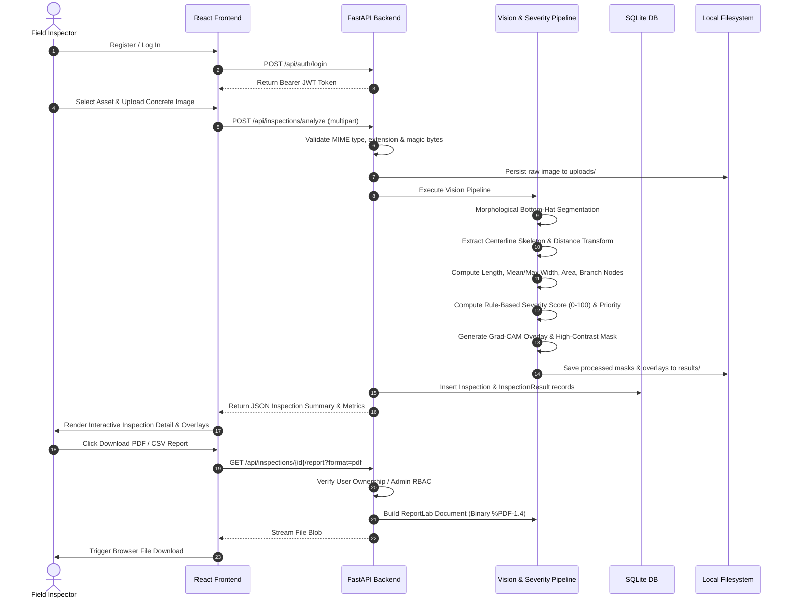

# InfraScan — Civil Infrastructure Damage Inspection Platform

[](https://fastapi.tiangolo.com)
[](https://react.dev)
[](https://pytorch.org)
[](https://www.docker.com)
[]()

InfraScan is a full-stack, AI-powered civil infrastructure damage inspection platform. It provides automated visual inspection, crack detection, high-contrast defect segmentation, quantitative geometric analysis, explainable rule-based severity assessment, role-based user management, and multi-format report exports for bridges, tunnels, retaining walls, pavements, and dams.

---

## Table of Contents

1. [Project Overview](#1-project-overview)
2. [Technology Stack](#2-technology-stack)
3. [System Architecture](#3-system-architecture)
4. [Application Workflow](#4-application-workflow)
5. [Installation & Setup](#5-installation--setup)
6. [Docker Deployment](#6-docker-deployment)
7. [API Overview](#7-api-overview)
8. [Testing & Verification](#8-testing--verification)
9. [Documentation & Deliverables](#9-documentation--deliverables)
10. [Technical Limitations](#10-technical-limitations)
11. [Future Enhancements](#11-future-enhancements)

---

## 1. Project Overview

### 1.1 Problem Statement
Conventional visual inspection of civil infrastructure assets is predominantly manual, hazardous, labor-intensive, and subjective. Field engineers face significant physical hazards when inspecting elevated bridges, highway retaining walls, and confined tunnel vaults. Furthermore, qualitative handwritten condition assessments introduce high variability between inspectors, lack standardized quantitative measurements, and impede longitudinal structural health monitoring.

### 1.2 Motivation
Rapidly identifying surface distress—particularly crack formation, propagation, and aperture widening—is critical to preventing catastrophic structural failures and optimizing maintenance budgets. InfraScan bridges the gap between raw field imagery and actionable engineering intelligence by delivering an automated, reproducible, and mathematically rigorous inspection pipeline accessible via a modern web interface.

### 1.3 Key Objectives
* **Automated Crack Screening**: Rapid binary classification of concrete surfaces to distinguish sound concrete from fractured surfaces.
* **Pixel-Level Defect Segmentation**: Extraction of precise damage boundary contours and pixel masks.
* **Quantitative Geometric Profiling**: Automated extraction of centerline skeleton length, mean/maximum crack aperture width, defect surface area, density, and structural branching nodes.
* **Explainable Severity Assessment**: Transparent, rule-based severity scoring ($0 - 100$) mapped to standardized maintenance priority actions, avoiding black-box decision making.
* **Role-Based Multi-Tenancy**: Complete isolation between regular inspectors and system administrators with fine-grained Role-Based Access Control (RBAC).
* **Engineering Report Generation**: Instant export of inspection dossiers in both structured tabular CSV and executive-ready binary PDF formats.

### 1.4 Intended Users
* **Field Structural Inspectors**: Civil engineers conducting routine, periodic, or emergency visual structural assessments.
* **Asset Managers & Municipal Authorities**: Highway, transit, and public works authorities overseeing large portfolios of civil assets.
* **Maintenance & Repair Contractors**: Engineering teams requiring quantified defect dimensions and precise location tags for repair prioritization.
* **Academic & Engineering Researchers**: Researchers evaluating computer vision algorithms on structural surface distress datasets.

### 1.5 Main Capabilities
* **Interactive Web Application**: Responsive React Single Page Application (SPA) with real-time analysis previews.
* **Geospatial Asset Tracking**: Interactive Leaflet GIS mapping displaying infrastructure assets, defect severity heatmaps, and GPS-tagged inspection locations.
* **Multi-User RBAC**: Dedicated User Dashboard (personal history, personal metrics) and Administrator Dashboard (system-wide oversight, user account activation/deactivation, fleet-wide defect analytics).
* **Explainability Visualizations**: Side-by-side inspection overlays including Grad-CAM spatial activation maps and segmented defect contours.
* **Multi-Format Export**: One-click download of binary PDF dossiers (embedded dual imagery, metadata, geometric metrics) and CSV data tables.

---

## 2. Technology Stack

InfraScan is built entirely upon established, production-grade open-source technologies:

| Domain | Technology / Library | Version | Operational Role |
|---|---|:---:|---|
| **Frontend Framework** | React (SPA) | 18.3.1 | Component-based interactive user interface |
| **Build Tool & Bundler** | Vite | 5.4.1 | High-performance frontend dev server and production bundler |
| **Styling & Icons** | Tailwind CSS / Lucide React | 3.4.1 / 0.460.0 | Modern utility styling, glassmorphism UI, and iconography |
| **Geospatial Mapping** | Leaflet / React-Leaflet | 1.9.4 / 4.2.1 | Interactive asset location maps and GPS coordinate rendering |
| **Backend Framework** | FastAPI | 0.115.5 | High-performance asynchronous Python REST API framework |
| **ASGI Server** | Uvicorn | 0.32.0 | Asynchronous Server Gateway Interface for backend execution |
| **Data Validation** | Pydantic | 2.9.2 | Strict request/response schema modeling and runtime validation |
| **Database & ORM** | SQLite 3 / SQLAlchemy | 2.0.36 | Relational persistence, declarative models, and parameterized queries |
| **Security & Auth** | PyJWT / Passlib (Bcrypt) | 2.10.0 / 1.7.4 | JWT token issuance (HS256) and secure password hashing |
| **Computer Vision** | OpenCV (`opencv-python-headless`) | 4.10.0.84 | Image decoding, morphological filtering, and contour processing |
| **Scientific Computing** | NumPy / SciPy / scikit-image | 1.26+ / 1.14+ / 0.24+ | Distance transforms, skeletonization, and geometric calculations |
| **Deep Learning** | PyTorch / Torchvision / Ultralytics | 2.5.1 / 0.20.1 / 8.3.34 | Machine learning framework and YOLO11 architecture support |
| **Report Generation** | ReportLab | 5.1.0 | Programmatic PDF document compilation with binary `%PDF-1.4` output |
| **Web Server / Reverse Proxy** | Nginx (Alpine) | 1.27-alpine | Reverse proxy, static asset delivery, and frontend routing in Docker |
| **Containerization** | Docker / Docker Compose | Compose v2 | Multi-container orchestration, volume isolation, and networking |

---

## 3. System Architecture

InfraScan follows a decoupled, layered micro-architecture separating presentation, routing, computational pipeline, and persistence.

```
+---------------------------------------------------------------------------------------+
|                                    CLIENT BROWSER                                     |
|  +--------------------+  +---------------------+  +------------------+  +----------+  |
|  | User Dashboard     |  | New Inspection Form |  | Inspection Detail|  | Admin UI |  |
|  +--------------------+  +---------------------+  +------------------+  +----------+  |
+-------------------------------------------|-------------------------------------------+
                                            | HTTP REST / JSON / Multipart
                                            v
+---------------------------------------------------------------------------------------+
|                        API GATEWAY / REVERSE PROXY (Nginx :80)                        |
|  - Reverse Proxies `/api/*` to FastAPI Backend (:8000)                                |
|  - Serves Compiled React SPA Production Assets (`/dist`)                              |
|  - Enforces Client Max Body Size (50M for High-Resolution Imagery)                   |
+-------------------------------------------|-------------------------------------------+
                                            v
+---------------------------------------------------------------------------------------+
|                               FASTAPI BACKEND (:8000)                                 |
|  +---------------------------------------------------------------------------------+  |
|  | Routers: /auth  |  /inspections  |  /dashboard  |  /admin  |  /assets  | /models|  |
|  +---------------------------------------------------------------------------------+  |
|  | Middleware: CORS, OAuth2 Password Bearer, Production JWT Guard, Exception Handler|  |
|  +----------------------------------------|----------------------------------------+  |
|                                           v                                           |
|  +---------------------------------------------------------------------------------+  |
|  |                            CORE SERVICES & AI PIPELINE                          |  |
|  |  +-------------------+  +--------------------+  +----------------------------+  |  |
|  |  | Image Validator   |  | Defect Segmentor   |  | Geometry Extractor         |  |  |
|  |  | (Type/Magic Check)|  | (Bottom-Hat/Otsu)  |  | (Skeleton/Dist Transform)  |  |  |
|  |  +-------------------+  +--------------------+  +----------------------------+  |  |
|  |  +-------------------+  +--------------------+  +----------------------------+  |  |
|  |  | Severity Engine   |  | Grad-CAM Visualizer|  | ReportLab PDF/CSV Generator|  |  |
|  |  | (Rule Heuristics) |  | (Spatial Heatmap)  |  | (Binary Report Engine)     |  |  |
|  |  +-------------------+  +--------------------+  +----------------------------+  |  |
|  +----------------------------------------|----------------------------------------+  |
+-------------------------------------------|-------------------------------------------+
                                            v
+---------------------------------------------------------------------------------------+
|                                  PERSISTENCE LAYER                                    |
|  +--------------------------------------------+  +---------------------------------+  |
|  |            SQLite 3 Relational DB          |  |       Filesystem Storage        |  |
|  |  - users (id, username, role, is_active)   |  |  - uploads/ (raw inspection jpg)|  |
|  |  - inspections (asset_id, user_id, meta)   |  |  - results/ (masks, overlays)   |  |
|  |  - inspection_results (geometry, severity) |  |  - reports/ (cached PDF, CSV)   |  |
|  |  - assets (name, type, gps_lat, gps_lon)   |  |  - models/  (checkpoint weights)|  |
|  +--------------------------------------------+  +---------------------------------+  |
+---------------------------------------------------------------------------------------+
```

Architecture source files:
* Rendered High-Resolution Diagram: [`docs/InfraScan_System_Architecture.png`](file:///E:/infosys/Internship/InfraScan/docs/InfraScan_System_Architecture.png)
* Mermaid Source: [`docs/InfraScan_System_Architecture.mmd`](file:///E:/infosys/Internship/InfraScan/docs/InfraScan_System_Architecture.mmd)
* Editable Draw.io XML: [`docs/InfraScan_System_Architecture.drawio`](file:///E:/infosys/Internship/InfraScan/docs/InfraScan_System_Architecture.drawio)

---

## 4. Application Workflow

The complete operational lifecycle follows an 11-stage pipeline:



---

## 5. Installation & Setup

### 5.1 Prerequisites
* **Operating System**: Windows 10/11, Ubuntu 22.04+, or macOS
* **Python**: Python 3.11, 3.12, or 3.13
* **Node.js**: Node.js v18.0+ and npm v9.0+
* **Git**: Installed and configured

### 5.2 Local Development Setup

#### Step 1: Clone Repository & Create Virtual Environment
```bash
# Clone the repository
git clone <repository-url>
cd InfraScan

# Create Python virtual environment
python -m venv venv

# Activate virtual environment
# On Windows (PowerShell):
.\venv\Scripts\Activate.ps1
# On Linux/macOS:
source venv/bin/activate
```

#### Step 2: Install Backend Dependencies
```bash
python -m pip install --upgrade pip
pip install -r requirements.txt
```

#### Step 3: Install Frontend Dependencies
```bash
cd frontend
npm install
cd ..
```

#### Step 4: Configure Environment Variables
Copy `.env.example` to create `.env`:
```bash
cp .env.example .env
```

Generate a secure 64-character JWT secret key:
```bash
# Using Python:
python -c "import secrets; print(secrets.token_hex(32))"

# Using OpenSSL:
openssl rand -hex 32

# Using PowerShell:
-join ((1..32) | ForEach-Object { '{0:x2}' -f (Get-Random -Max 256) })
```
Update `.env` with the generated secret:
```env
INFRASCAN_ENV=development
INFRASCAN_JWT_SECRET=your_generated_secret_key_here
INFRASCAN_JWT_ALGORITHM=HS256
INFRASCAN_JWT_EXPIRE_MINUTES=1440
INFRASCAN_DATA_DIR=./data
INFRASCAN_MODELS_DIR=./models
```

#### Step 5: Start the Backend Server
```bash
# From the project root:
python -m uvicorn backend.main:app --host 127.0.0.1 --port 8000 --reload
```
* Backend API root: `http://127.0.0.1:8000`
* Interactive OpenAPI Swagger documentation: `http://127.0.0.1:8000/docs`

#### Step 6: Start the Frontend Application
```bash
# In a separate terminal session:
cd frontend
npm run dev -- --host 127.0.0.1 --port 5173
```
* Web application interface: `http://127.0.0.1:5173`

---

## 6. Docker Deployment

InfraScan features a production-ready multi-container Docker Compose configuration with hardened security and persistent volumes.

### 6.1 Quick Launch
```bash
# 1. Prepare environment configuration
cp .env.example .env

# 2. Set INFRASCAN_ENV=production and configure a 32+ char secret in .env
# Production startup will strictly fail if INFRASCAN_JWT_SECRET is unset or a placeholder

# 3. Build and launch services in background
docker compose up -d --build
```

### 6.2 Service Endpoints
* **Frontend Application & Reverse Proxy**: `http://localhost:80`
* **Backend API**: `http://localhost:8000`
* **API Documentation**: `http://localhost:8000/docs`

### 6.3 Persistent Data & Volumes
Container data is preserved across restarts inside the named volume `infrascan_data`:
* **Database**: `/app/data/infrascan.db`
* **Uploads**: `/app/data/uploads`
* **Masks & Overlays**: `/app/data/results`
* **Reports**: `/app/data/reports`
* **Model Checkpoints**: Read-only mount from host `./models` to container `/app/models:ro`

> [!WARNING]
> Never execute `docker compose down -v` in production. The `-v` flag deletes all named volumes and will permanently wipe the SQLite database, uploaded photos, and generated inspection reports. To stop containers safely, use `docker compose down`.

---

## 7. API Overview

All protected endpoints require an `Authorization: Bearer <token>` header.

### 7.1 Authentication & Profile (`/api/auth`)
* `POST /api/auth/register` — Register a new inspector (strictly enforces `role: "user"`).
* `POST /api/auth/login` — Authenticate credentials and receive a 24-hour JWT token.
* `GET /api/auth/me` — Retrieve the authenticated user's profile (sensitive hashes omitted).
* `PUT /api/auth/profile` — Update username, email, or password for the current user.

### 7.2 Inspections & Analysis (`/api/inspections`)
* `POST /api/inspections/analyze` — Upload concrete image, execute vision pipeline, store results.
* `GET /api/inspections` — Retrieve paginated inspection history for the authenticated user.
* `GET /api/inspections/{id}` — Retrieve detailed geometric metrics and overlay paths for an inspection.
* `GET /api/inspections/{id}/report?format={pdf|csv}` — Download binary PDF dossier or CSV table.
* `DELETE /api/inspections/{id}` — Delete an inspection (restricted to record owner or admin).

### 7.3 Dashboards & Analytics (`/api/dashboard`)
* `GET /api/dashboard/user-stats` — User-isolated metrics (total inspections, cracks, critical count).
* `GET /api/dashboard/recent-activity` — Recent inspections conducted by the authenticated user.

### 7.4 Administration & Governance (`/api/admin`)
* `GET /api/admin/overview` — Fleet-wide statistics (total users, total inspections, defect counts).
* `GET /api/admin/users` — List all registered users and their account activation status.
* `PUT /api/admin/users/{id}/status` — Activate or deactivate an inspector account.
* `GET /api/admin/inspections` — System-wide inspection records across all users.

### 7.5 Infrastructure Assets (`/api/assets`)
* `GET /api/assets` — Retrieve list of registered civil infrastructure assets with GPS coordinates.
* `POST /api/assets` — Register a new asset (bridges, tunnels, retaining walls, pavements).

---

## 8. Testing & Verification

InfraScan includes an automated integration and regression test suite verifying multi-user workflows, security boundaries, AI determinism, and error handling.

### 8.1 Running the Integration Suite
With the backend running on `127.0.0.1:8000`:
```bash
python scratch/run_m4_3_full_suite.py
```

### 8.2 Summary of Verified Test Results
The automated test runner executes **34 discrete integration tests** with **0 failures**:

| Category | Count | Status | Verified Capabilities |
|---|:---:|:---:|---|
| **Health API** (`INT-01`) | 1 | **PASSED** | Backend service availability and health endpoint response. |
| **User Journey** (`INT-02`–`INT-10`) | 9 | **PASSED** | Registration, privilege escalation block, login, isolated dashboard stats, upload analysis, detail fetch, history isolation, PDF export, CSV export, session persistence. |
| **Admin Journey** (`INT-11`–`INT-17`) | 7 | **PASSED** | Admin authentication, system-wide stats, user registry, account deactivation lifecycle, account reactivation lifecycle, system-wide inspection access, system-wide report download. |
| **Security & RBAC** (`SEC-01`–`SEC-07`) | 7 | **PASSED** | Cross-tenant inspection detail blocked (403), cross-tenant PDF/CSV download blocked (403), regular user blocked from admin APIs (403), unauthenticated request blocked (401), invalid JWT signature rejected (401), zero credential leakage in user serialization. |
| **AI Regression** (`AI-01`–`AI-05`) | 5 | **PASSED** | Deterministic outputs across sound concrete (0.0/100), longitudinal crack (80.0/100), alligator crack (80.0/100), hairline fracture (80.0/100), and critical progression (95.0/100). |
| **Error Handling** (`ERR-01`–`ERR-05`) | 5 | **PASSED** | Rejection of non-image extensions (415), corrupted image payloads (400), empty files (400), non-existent report IDs (404), invalid format parameters (422). |
| **Total Executed** | **34** | **100% PASSED** | **Full end-to-end integration verified.** |

For individual test case breakdowns and evidence, see [`docs/M4_3_test_matrix.md`](file:///E:/infosys/Internship/InfraScan/docs/M4_3_test_matrix.md).

---

## 9. Documentation & Deliverables

Comprehensive milestone documentation, audit reports, guides, and evidence files are available in `docs/`:

* **Milestone 4 Completion Report**: [`docs/M4_FINAL_COMPLETION_REPORT.md`](file:///E:/infosys/Internship/InfraScan/docs/M4_FINAL_COMPLETION_REPORT.md) — Comprehensive synthesis of M4.1–M4.5.
* **Final Submission Checklist**: [`docs/M4_FINAL_SUBMISSION_CHECKLIST.md`](file:///E:/infosys/Internship/InfraScan/docs/M4_FINAL_SUBMISSION_CHECKLIST.md) — Itemized academic readiness audit.
* **Project Demonstration Guide**: [`docs/InfraScan_Demo_Guide.md`](file:///E:/infosys/Internship/InfraScan/docs/InfraScan_Demo_Guide.md) — 10–12 minute live presentation script with timestamps and presenter actions.
* **Screenshot Evidence Index**: [`docs/screenshots/README.md`](file:///E:/infosys/Internship/InfraScan/docs/screenshots/README.md) — Index of all 17 genuine application screenshots.
* **System Architecture**:
  * Rendered Diagram: [`docs/InfraScan_System_Architecture.png`](file:///E:/infosys/Internship/InfraScan/docs/InfraScan_System_Architecture.png)
  * Mermaid Source: [`docs/InfraScan_System_Architecture.mmd`](file:///E:/infosys/Internship/InfraScan/docs/InfraScan_System_Architecture.mmd)
  * Draw.io Source: [`docs/InfraScan_System_Architecture.drawio`](file:///E:/infosys/Internship/InfraScan/docs/InfraScan_System_Architecture.drawio)
* **Milestone Audits**:
  * M4.1 Dashboard & RBAC: [`docs/M4_1_dashboard_audit.md`](file:///E:/infosys/Internship/InfraScan/docs/M4_1_dashboard_audit.md)
  * M4.2 Reports & Exports: [`docs/M4_2_reports_exports.md`](file:///E:/infosys/Internship/InfraScan/docs/M4_2_reports_exports.md)
  * M4.3 Integration Testing: [`docs/M4_3_integration_testing.md`](file:///E:/infosys/Internship/InfraScan/docs/M4_3_integration_testing.md) & [`docs/M4_3_test_matrix.md`](file:///E:/infosys/Internship/InfraScan/docs/M4_3_test_matrix.md)
  * M4.4 Docker Deployment: [`docs/M4_4_docker_deployment.md`](file:///E:/infosys/Internship/InfraScan/docs/M4_4_docker_deployment.md)
  * M3 Model & Detection: [`docs/M3_1_model_detection_audit.md`](file:///E:/infosys/Internship/InfraScan/docs/M3_1_model_detection_audit.md) & [`docs/M3_2_severity_geometry.md`](file:///E:/infosys/Internship/InfraScan/docs/M3_2_severity_geometry.md)

---

## 10. Technical Limitations

To maintain academic honesty and engineering integrity, the following limitations are explicitly documented:

1. **Uncalibrated Optical Measurements**: All extracted crack dimensions (area, length, mean width, maximum aperture) are computed strictly in image-space pixels (`px`). In the absence of a calibrated physical reference scale (such as a checkerboard fiducial marker, laser scale, or fixed camera distance), pixel values cannot be converted to millimeters or inches.
2. **Crack Width is an Image-Space Proxy**: Crack aperture width is estimated using the Euclidean distance transform along the morphological skeleton. It serves as an approximation and is subject to optical blur, lighting angles, and surface texture irregularities.
3. **Rule-Based Decision-Support Heuristics**: The severity scoring algorithm ($0 - 100$) is a deterministic heuristic combining crack density, maximum aperture width, and topological branching. It is designed for preliminary screening and triaging, not as an automated structural pass/fail certification.
4. **Not a Certified Structural Safety Tool**: InfraScan is an engineering decision-support tool. It does not replace on-site physical inspection, non-destructive testing (ultrasonic, rebound hammer), or formal sign-off by a licensed Professional Engineer (PE).
5. **AI Checkpoint Provenance**: The active model file `models/yolo_best.pt` is an Ultralytics YOLO11s checkpoint trained on the 80-class COCO general object dataset. It is strictly isolated from crack severity scoring. Custom-trained Keras checkpoints (`cnn_crack_classifier_best.keras` and `unet_crack500_best.keras`) are currently absent on disk; active segmentation is driven by deterministic computer vision.
6. **Historical Model Metrics**: Historical experimental benchmark results (e.g., CNN 99.69% accuracy on SDNET2018; U-Net 0.5408 IoU on CRACK500; YOLO11s 0.8064 mAP50 on Colab) reflect standalone research experiments and do not represent active inference from locally deployed weights.
7. **Single-Node SQLite Database**: The current database uses SQLite 3. While suitable for single-server and demonstration deployments with write concurrency handling via WAL mode, large enterprise fleets require migration to a client-server RDBMS such as PostgreSQL.

---

## 11. Future Enhancements

* **Physical Metric Calibration**: Incorporate automated fiducial target detection (AprilTags or ArUco markers) to compute real-world millimeter scale factors ($\text{mm/pixel}$) automatically.
* **Custom Model Deployment**: Fine-tune and deploy lightweight edge models (YOLO11-seg or MobileNet-UNet) trained directly on civil surface crack datasets (CRACK500, DeepCrack, SDNET2018).
* **Enterprise Database Migration**: Transition persistence layer from SQLite to PostgreSQL with Alembic migrations and connection pooling.
* **3D Photogrammetry & Digital Twins**: Integrate multi-view structure-from-motion (SfM) reconstruction to map segmented crack networks onto 3D BIM models.
* **Mobile Field App**: Develop an offline-first companion mobile application for field inspectors with automated GPS tagging and edge inferencing.

---

## License

This project was developed for the Infosys Springboard Internship program. All rights reserved.