# Milestone 2: Model Evaluation Report

**Project:** InfraScan — Surface Defect Assessment  
**Evaluation Scope:** Classification, Object Detection, Semantic Segmentation, and Morphological Geometry  
**Status:** Complete  
**Date:** October 31, 2026  

---

## 1. Executive Summary & Plan Target Alignment

The project plan defines four evaluation targets:
1. **Classification Target**: Macro F1 $\ge 85\%$ (0.85) where the data allows.
2. **Object Detection Target**: $\text{mAP@50} \ge 85\%$ (0.85) and $\text{Recall} \ge 90\%$ (0.90).
3. **Semantic Segmentation Target**: $\text{Dice} \ge 85\%$ (0.85) and $\text{IoU} \ge 75\%$ (0.75).
4. **Inference Latency Target**: Under 3.0 seconds on the chosen GPU.

Every number in this report is read from existing JSON, CSV, and run_card files on disk (detailed in [docs/12_number_sources.csv](file:///d:/Infosys%20springboards/docs/12_number_sources.csv)). No numbers are estimated. Results are labeled by split (**TRAIN**, **VALIDATION**, or **TEST**).

### Summary Target Comparison Table

| Task / Domain | Target Metric | Plan Target | Split | Actual Result Achieved | Target Status |
| :--- | :---: | :---: | :---: | :---: | :---: |
| **Classification (CCIC)** | Macro F1 | $\ge 85\%$ | **TEST** | **0.9997** | **Reached** |
| **Classification (SDNET2018)** | Macro F1 | $\ge 85\%$ | **TEST** | **0.6421** | **Not reached** |
| **Object Detection (RDD2022)** | mAP@50 | $\ge 85\%$ | **VALIDATION** | **0.4554** (v8s) / 0.4437 (11s) | **Not reached** (Test split not evaluated) |
| **Object Detection (RDD2022)** | Recall | $\ge 90\%$ | **VALIDATION** | **0.4528** (v8s) / 0.4161 (11s) | **Not reached** (Test split not evaluated) |
| **Segmentation (Crack500)** | Mean Dice | $\ge 85\%$ | **TEST** | **0.6899** | **Not reached** |
| **Segmentation (Crack500)** | Mean IoU | $\ge 75\%$ | **TEST** | **0.5481** | **Not reached** |
| **Segmentation (CFD External)** | Mean Dice | $\ge 85\%$ | **TEST** | **0.4533** | **Not reached** |
| **Segmentation (CFD External)** | Mean IoU | $\ge 75\%$ | **TEST** | **0.3109** | **Not reached** |
| **Inference Latency** | Latency / image | $< 3.0\,\text{s}$ on GPU | **TEST** | **1,349 ms** (Host CPU) | **Not assessed on GPU** |

---

## 2. Defect Classification

Two ResNet-50 classification models were trained and evaluated on held-out test splits.

### 2.1 Concrete Crack Images (`concrete_crack_cls`)

- **Dataset**: CCIC (Concrete Crack Images for Classification), $N = 5,760$ test images.
- **Operating Threshold**: 0.4951 (**TEST**).
- **Macro F1**: **0.9997** (**TEST**). Plan target ($\ge 85\%$) is **Reached**.
- **Metrics Table (TEST)**:
  - Accuracy: 0.9997
  - Balanced Accuracy: 0.9997
  - Precision (Crack): 0.9997
  - Recall (Crack): 0.9997
  - Specificity: 0.9996
  - Crack-class F1: 0.9997
  - No-crack class F1: 0.9996
  - Macro F1: 0.9997
  - AUC-ROC: 1.0000
  - Average Precision (PR-AUC): 1.0000
  - Confusion Matrix: $\text{TP} = 2951, \quad \text{FP} = 1, \quad \text{TN} = 2807, \quad \text{FN} = 1$
- **Dataset Context & Leakage**: Results on this dataset are very high. The dataset is easy, featuring clear cracks on uniform concrete tiles. Crops from the same photo may be in different splits (this is not fully checkable from dataset metadata). A perceptual hash check (`near_duplicate_summary.json`) found 931 near-duplicates out of 5,760 test images (16.16% at dHash $\le 2$). On the 4,829 non-duplicate test images, F1 is 0.9995.
- **Best Epoch Selection**: `model_card.json` reports `best_epoch: 0` due to a default initialization logging bug in the training script. In `history.csv`, validation loss reached its minimum of 0.0008 and validation F1 peaked at 0.9997 at **Epoch 13**. Epoch 13 from `history.csv` is used.
- **Latency & Size**: Checkpoint size is 89.97 MB (**TRAIN**). Single image latency on host CPU is 9.19 ms (**TEST**, `test_metrics.json`). GPU latency was not recorded.

#### Figures: Concrete Crack Images Classifier
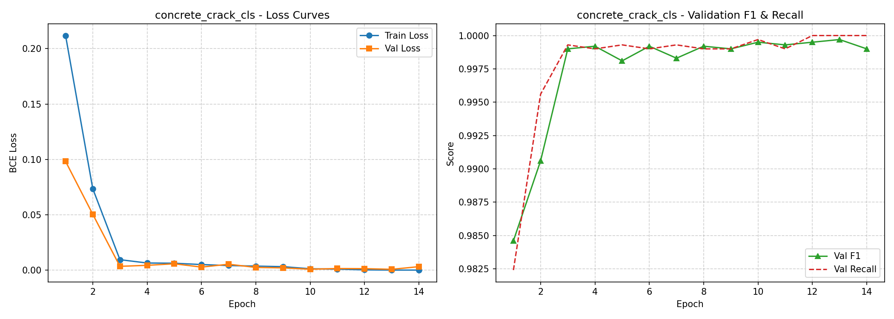  
*Figure 1: Training and validation loss/F1 curves across 15 epochs for Concrete Crack Classifier (TRAIN/VALIDATION).*

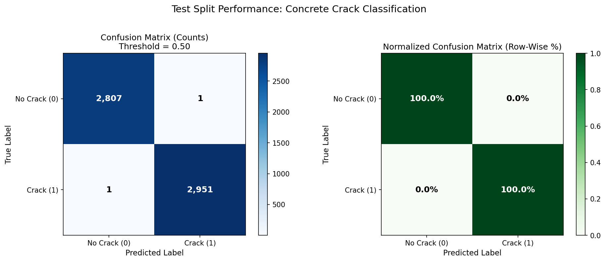  
*Figure 2: Test confusion matrix for Concrete Crack Classifier at threshold 0.4951 (TEST).*

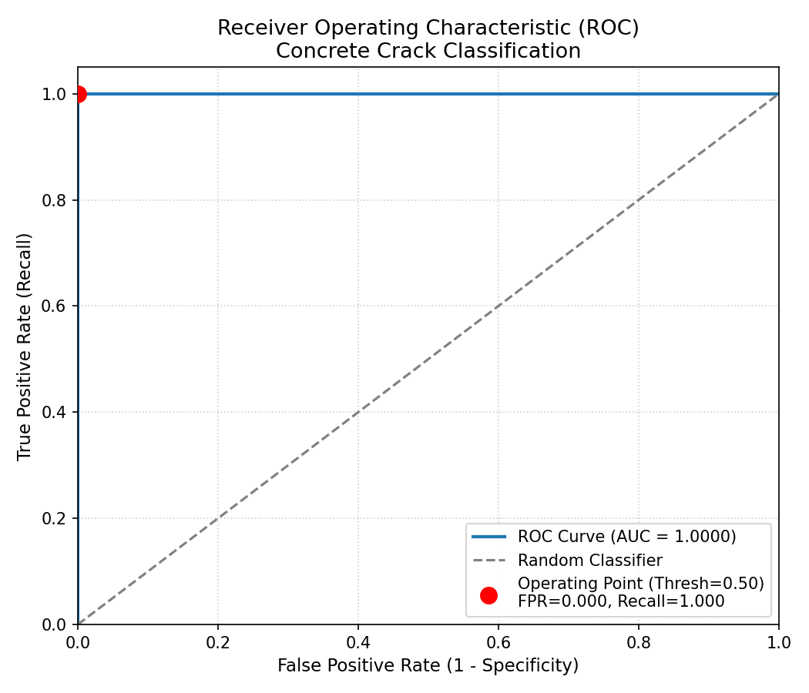  
*Figure 3: Test ROC curve for Concrete Crack Classifier, AUC = 1.0000 (TEST).*

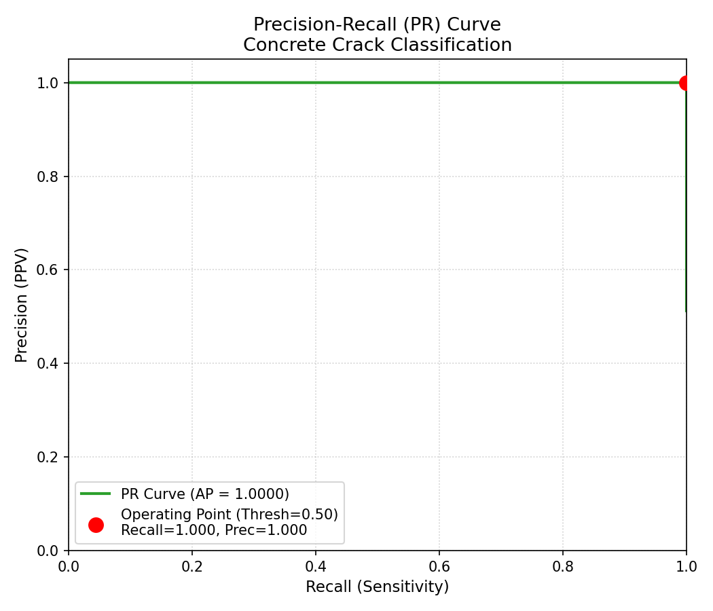  
*Figure 4: Test Precision-Recall curve for Concrete Crack Classifier, AP = 1.0000 (TEST).*

---

### 2.2 SDNET2018 (`sdnet2018`)

- **Dataset**: SDNET2018, $N = 8,802$ test images (1,255 crack, 7,547 no-crack).
- **Operating Threshold**: 0.0100 (**TEST**).
- **Macro F1**: **0.6421** (**TEST**). Plan target ($\ge 85\%$) is **Not reached**.
  - Crack-class F1: 0.4815
  - No-crack class F1: 0.8027
  - Macro F1: $(0.4815 + 0.8027) / 2 = \mathbf{0.6421}$
- **Threshold Selection Rule**: The threshold of 0.0100 was selected on the validation split by enforcing a rule of $\text{Recall} \ge 0.90$. This rule is how the threshold was chosen on validation, not an independent target.
- **Precision**: At threshold 0.0100, precision is low at **0.3247** (about 0.32), resulting in 2,429 false positives (**TEST**).
- **Metrics Table (TEST)**:
  - Accuracy: 0.7142
  - Balanced Accuracy: 0.8044
  - Precision (Crack): 0.3247
  - Recall (Crack): 0.9307
  - Specificity: 0.6782
  - Crack-class F1: 0.4815
  - No-crack class F1: 0.8027
  - Macro F1: 0.6421
  - AUC-ROC: 0.9342
  - Average Precision (PR-AUC): 0.8419
  - Confusion Matrix: $\text{TP} = 1168, \quad \text{FP} = 2429, \quad \text{TN} = 5118, \quad \text{FN} = 87$
- **Per-Surface Breakdown (`metrics_by_group.csv`, TEST)**:
  - **Bridge Decks (D)**: 2,268 images (290 crack / 1,978 no-crack); Recall: 0.9276, Precision: 0.2325, F1: 0.3718, Specificity: 0.5511, AUC-ROC: 0.9082.
  - **Pavements (P)**: 3,510 images (367 crack / 3,143 no-crack); Recall: **0.8965** (pavement recall was below 0.90), Precision: 0.3194, F1: 0.4710, Specificity: 0.7770, AUC-ROC: 0.9307.
  - **Walls (W)**: 3,024 images (598 crack / 2,426 no-crack); Recall: 0.9532, Precision: 0.4043, F1: 0.5677, Specificity: 0.6538, AUC-ROC: 0.9486.
- **Training Dynamics & Overfitting**: In `history.csv`, validation loss was lowest at **Epoch 7** ($\text{val\_loss} = 0.4955$). Afterwards, training loss continued to drop ($0.0820 \to 0.0150$ at Epoch 14), while validation loss rose to 0.7225 at Epoch 14, showing overfitting (**VALIDATION**).
- **Leakage**: Perceptual hash check found 7 near-duplicates out of 8,802 test images (0.08% at dHash $\le 2$).
- **Latency & Size**: Checkpoint size is 89.97 MB (**TRAIN**). Single image latency on host CPU is 9.53 ms (**TEST**, `test_metrics.json`). GPU latency was not recorded.

#### Figures: SDNET2018 Classifier
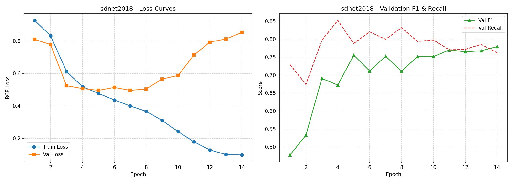  
*Figure 5: Training and validation loss/F1 curves across 15 epochs for SDNET2018 Classifier (TRAIN/VALIDATION).*

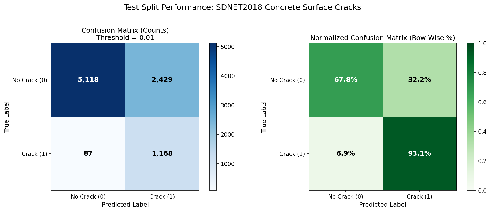  
*Figure 6: Test confusion matrix for SDNET2018 Classifier at threshold 0.0100 (TEST).*

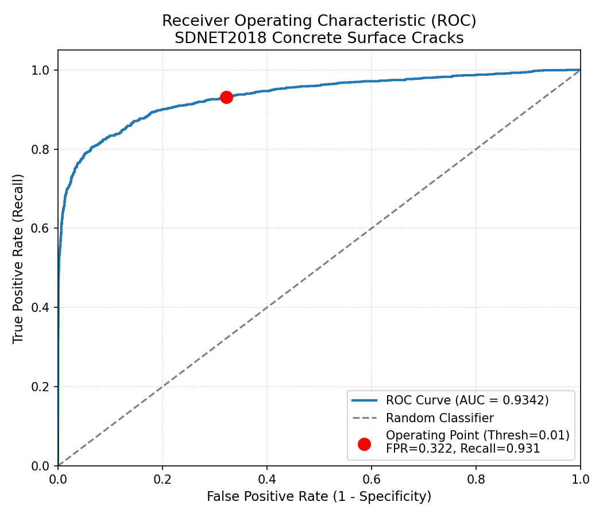  
*Figure 7: Test ROC curve for SDNET2018 Classifier, AUC = 0.9342 (TEST).*

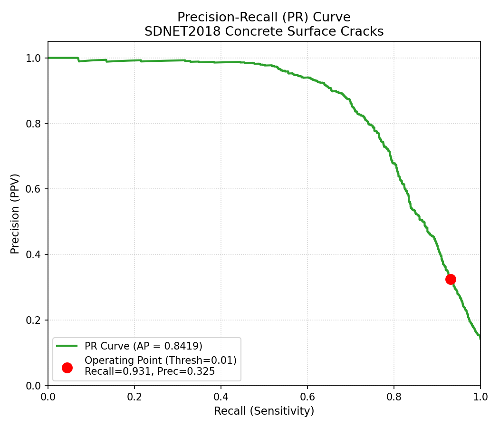  
*Figure 8: Test Precision-Recall curve for SDNET2018 Classifier, AP = 0.8419 (TEST).*

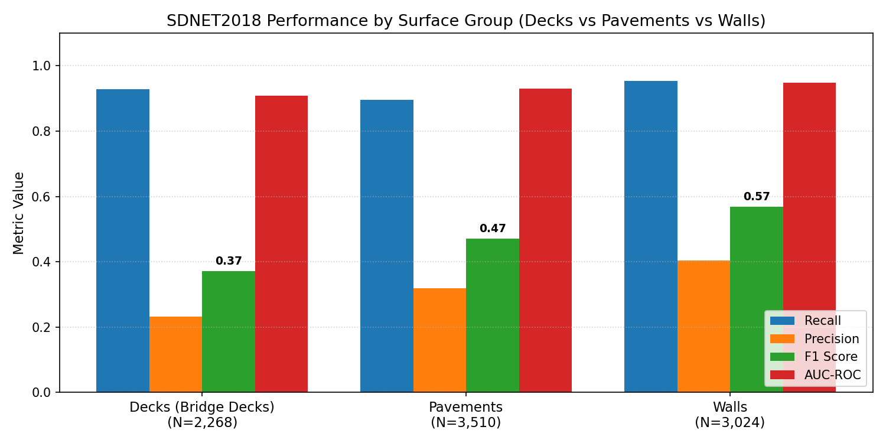  
*Figure 9: Test performance metrics disaggregated by surface type: Bridge Decks (D), Pavements (P), and Walls (W) (TEST).*

---

## 3. Road Damage Object Detection (RDD2022)

Two object detection architectures (YOLOv8s and YOLO11s) were trained on the RDD2022 dataset.

- **Training Subset**: Both runs used the 8,000-image training subset of RDD2022 (`data/processed/rdd2022_yolo_small`, 8,000 images in `images/train`). The validation set contains 1,500 images.
- **Split Status**: **Test split not evaluated** (no test evaluation file exists; all reported metrics are **VALIDATION**).
- **Target Classes**: D00 (longitudinal crack), D10 (transverse crack), D20 (alligator crack), D40 (pothole).

### 3.1 Validation Results (`results.csv`)

| Model | Evaluated Split | Epoch | Precision | Recall | mAP@50 | mAP@50:95 |
| :--- | :---: | :---: | :---: | :---: | :---: | :---: |
| **YOLOv8s** | **VALIDATION** | Epoch 38 (Best mAP@50) | 0.5211 | 0.4528 | **0.4554** | **0.2220** |
| YOLOv8s | **VALIDATION** | Epoch 40 (Final) | 0.5505 | 0.4440 | 0.4545 | 0.2220 |
| **YOLO11s** | **VALIDATION** | Epoch 38 (Best mAP@50) | 0.5534 | 0.4161 | **0.4437** | **0.2151** |
| YOLO11s | **VALIDATION** | Epoch 40 (Final) | 0.5457 | 0.4197 | 0.4415 | 0.2159 |

- **Model Comparison**:
  - The mAP@50:95 gap between YOLOv8s (0.2220) and YOLO11s (0.2159) is from one run each and is small (difference of 0.0061).
  - The final detection model is chosen by validation mAP@50:95: **`yolov8s_rdd2022`** is the final model.
- **Plan Target Status**:
  - Targets: $\text{mAP@50} \ge 85\%$ and $\text{Recall} \ge 90\%$.
  - Achieved on validation: $\text{mAP@50} = 0.4554$, $\text{Recall} = 0.4528$.
  - Status: **Not reached** on validation; test split not evaluated.

#### Figures: YOLOv8s Detection Run
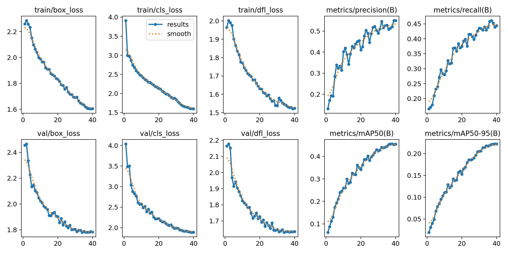  
*Figure 10: Training losses and validation metrics across 40 epochs for YOLOv8s on RDD2022 (TRAIN/VALIDATION).*

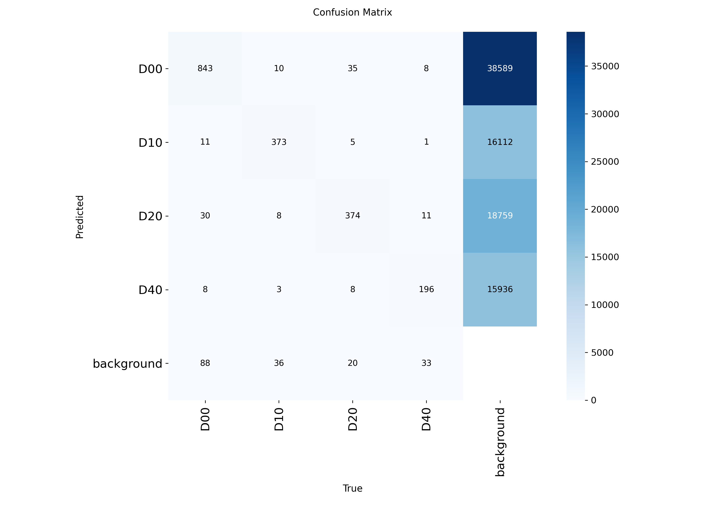  
*Figure 11: Validation confusion matrix for YOLOv8s on RDD2022 (VALIDATION).*

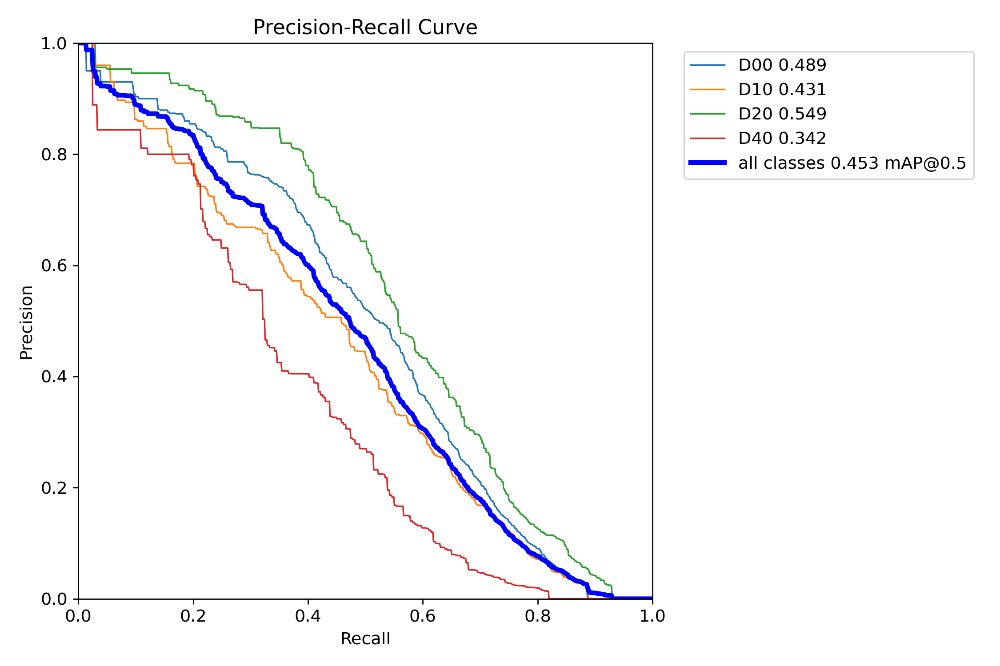  
*Figure 12: Validation Precision-Recall curve for YOLOv8s on RDD2022 (VALIDATION).*

---

## 4. Semantic Crack Segmentation

### 4.1 Model Selection & Validation Reproducibility

- Two models were trained on Crack500: U-Net++ and standard U-Net, both with ResNet-34 backbones pretrained on ImageNet.
- **Model Winner Selection**: The winner is chosen by **VALIDATION Dice**:
  - **U-Net++ (`unetplusplus_crack500`)**: Validation Dice = **0.7482** at optimal threshold 0.40 (**VALIDATION**, `run_card.json`). Val IoU = 0.6265, Val Precision = 0.7698, Val Recall = 0.7962.
  - **Standard U-Net (`unet_crack500`)**: Validation Dice = **0.7335** at optimal threshold 0.25 (**VALIDATION**, `run_card.json`). Val IoU = 0.6056.
  - U-Net++ was selected by higher validation Dice (difference: 0.0147).
- **Validation Reproducibility**: Recomputing validation metrics locally from `best.pth` produced Dice = 0.748205 vs expected card value 0.7482 (difference of 0.000005, **VALIDATION**).
- **Test Metrics Files Check**: `evaluation/crack500_test_metrics.json` and `evaluation/crack500/crack500_test_metrics.json` are byte-identical (both have SHA-256: `003ae93521ad9a902d6af51b71aac8152fd05ef0a9483ae83877063ad567a7b8`).

---

### 4.2 Test Split Results: Crack500 and CFD

- **Crack500 Test Split**: 1,087 clean test images (**TEST**). The raw test crop archive had 1,124 images; 37 crops were removed during data cleaning because their parent source photos had other crops in the train or validation splits (`docs/08_dataset_cleaning.md`).
- **CFD Test Split**: 118 images (**TEST**), evaluated using the winning model at threshold 0.40 without fine-tuning.

#### Test Metrics Summary

| Metric | Crack500 Test ($N = 1,087$) | CFD External Test ($N = 118$) |
| :--- | :---: | :---: |
| **Split** | **TEST** | **TEST** |
| **Operating Threshold** | 0.40 | 0.40 |
| **Mean Dice** | **0.6899** [0.6801, 0.7001] | **0.4533** [0.4187, 0.4873] |
| **Mean IoU** | **0.5481** [0.5382, 0.5586] | **0.3109** [0.2839, 0.3384] |
| **Precision** | 0.6933 | 0.4390 |
| **Recall** | 0.7442 | 0.7024 |
| **Pixel-Pooled Dice** | 0.7309 | 0.4214 |
| **Pixel-Pooled IoU** | 0.5759 | 0.2669 |
| **Boundary F1 (3px)** | 0.4523 | 0.5906 |
| **Pixel Accuracy** | 0.9696 | 0.9663 |
| **Specificity** | 0.9826 | 0.9764 |

- **Plan Target Status**:
  - Targets: $\text{Dice} \ge 85\%$ and $\text{IoU} \ge 75\%$.
  - Crack500: $\text{Dice} = 0.6899$, $\text{IoU} = 0.5481$ $\implies$ **Not reached**.
  - CFD: $\text{Dice} = 0.4533$, $\text{IoU} = 0.3109$ $\implies$ **Not reached**.
- **Data Leakage (Crack500)**: Perceptual hash check between 1,860 training crops and 1,087 test crops found 0 shared parent photos, 0 exact duplicates ($d = 0$), and 0 near-duplicates ($d \le 2$). Mean minimum Hamming distance is 17.80 bits.
- **Empty Predictions**: 17 images out of 1,087 (1.56%, ~1.6%) produced empty predicted masks ($A = 0\,\text{px}$) after filtering, representing complete misses (**TEST**). In the ground truth, 0 masks are empty (`has_crack = True` for all 1,087 images).

---

### 4.3 Crack Thickness Breakdown & Dataset Comparison

- **Within-Dataset Thickness Groups (Terciles)**:
  - In each dataset, images are divided into thin, medium, and thick terciles based on true-mask mean crack width.
  - **The thin/medium/thick groups are terciles computed inside each dataset, so they are not comparable across datasets**.
  - **Crack500 Terciles (TEST)**:
    - Thin: 363 images, width range $[3.75, 13.05\,\text{px}]$, mean width 9.62 px, Mean Dice = **0.630** (0.6296), Mean IoU = 0.4804, Recall = 0.7504.
    - Medium: 362 images, width range $[13.06, 21.31\,\text{px}]$, mean width 16.99 px, Mean Dice = **0.710** (0.7095), Mean IoU = 0.5650, Recall = 0.7570.
    - Thick: 362 images, width range $[21.34, 73.02\,\text{px}]$, mean width 30.28 px, Mean Dice = **0.731** (0.7308), Mean IoU = 0.5989, Recall = 0.7252.
  - **CFD Terciles (TEST)**:
    - Thin: 40 images, width range $[2.08, 3.06\,\text{px}]$, mean width 2.76 px, Mean Dice = **0.347** (0.3472), Mean IoU = 0.2223, Recall = 0.6237.
    - Medium: 39 images, width range $[3.07, 3.85\,\text{px}]$, mean width 3.41 px, Mean Dice = **0.473** (0.4727), Mean IoU = 0.3232, Recall = 0.7430.
    - Thick: 39 images, width range $[3.89, 40.76\,\text{px}]$, mean width 6.96 px, Mean Dice = **0.543** (0.5428), Mean IoU = 0.3896, Recall = 0.7426.

- **Width and Gap Observations**:
  - **Dice is lower for thinner cracks in both datasets**: Crack500 Dice drops from 0.731 (thick) $\to$ 0.710 (medium) $\to$ 0.630 (thin); CFD Dice drops from 0.543 (thick) $\to$ 0.473 (medium) $\to$ 0.347 (thin).
  - **CFD true-mask mean width is 4.38 px versus 18.96 px for Crack500**.
  - **Other causes were not tested**.

- **CFD Width Range Comparison**:
  - In the CFD thin range $[2.08, 3.06\,\text{px}]$, Crack500 has **0 images** (Crack500 minimum width is 3.75 px). Direct comparison cannot be done.
  - In the CFD medium range $[3.07, 3.85\,\text{px}]$, Crack500 has only **1 image** (mean width 3.75 px, Dice 0.4059, IoU 0.2546). A statistical comparison cannot be done with $N = 1$.
  - In the overlapping width band $[3.89, 10.0\,\text{px}]$:
    - Crack500 ($N = 191$, mean width 7.93 px): Mean Dice is **0.6163**, Mean IoU is **0.4633**.
    - CFD ($N = 35$, mean width 4.93 px): Mean Dice is **0.5654**, Mean IoU is **0.4084**.

---

### 4.4 Latency & Complexity

- Checkpoint size: **99.66 MB** (**TRAIN**, `speed_and_size.json`).
- Total parameters: **26,078,609** (**TRAIN**, all trainable).
- **Latency (TEST)**:
  - Segmentation model alone, 384x640 input, host CPU: **1,349 ms per image** (mean 1,349.14 ms, median 1,331.18 ms, p95 1,510.49 ms; throughput 0.74 images/s).
  - Target ($< 3.0\,\text{s}$ on GPU): **Not assessed on GPU** (no GPU latency measurement exists in test files or run cards; `run_card.json` records hardware device name `Tesla T4` at training time, but without measured latency).

#### Missing Figures Note
- `segmentation curves.png`: **Missing** (not found on disk).
- `segmentation val_examples.png`: **Missing** (not found on disk).

#### Figures: Segmentation Evaluation
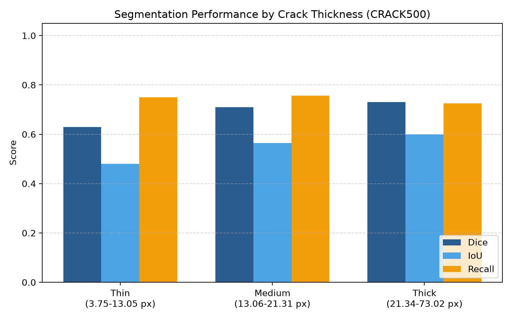  
*Figure 13: Crack500 test set metrics stratified across thin, medium, and thick terciles (TEST).*

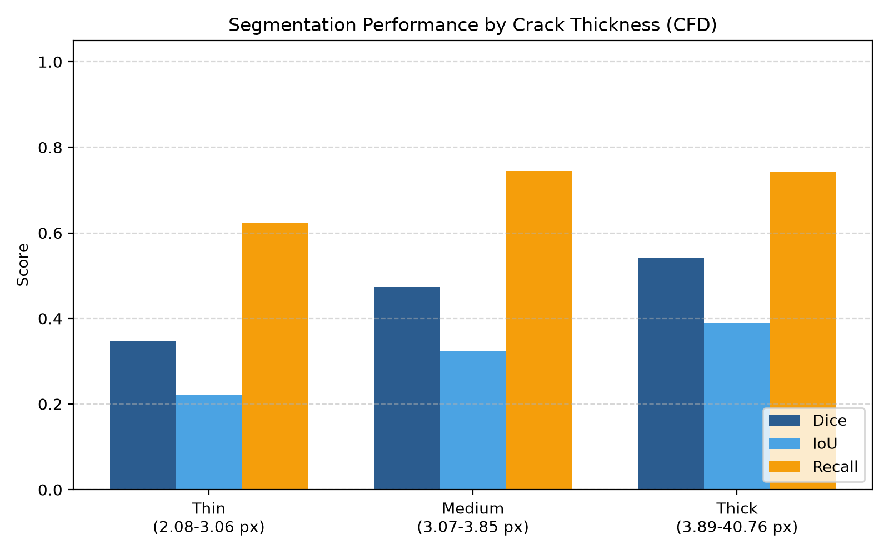  
*Figure 14: CFD external test set metrics stratified across thin, medium, and thick terciles (TEST).*

##### Crack500 Test Panels (2 Best, 2 Median, 2 Worst)
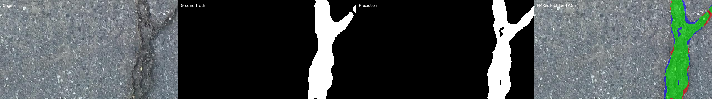  
*Figure 15: Crack500 test example — Best rank 1 (Dice = 0.9165) (TEST).*

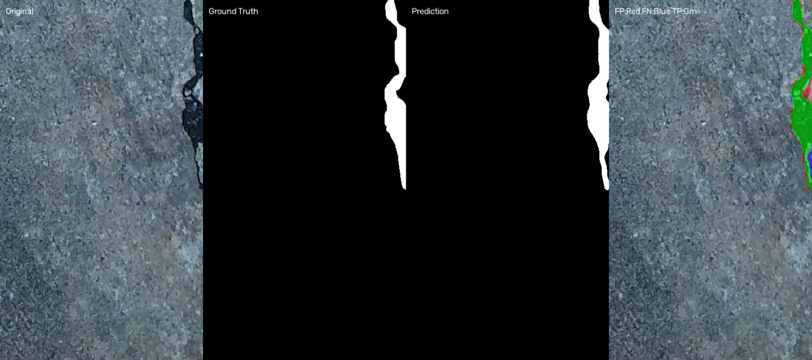  
*Figure 16: Crack500 test example — Best rank 2 (Dice = 0.9177) (TEST).*

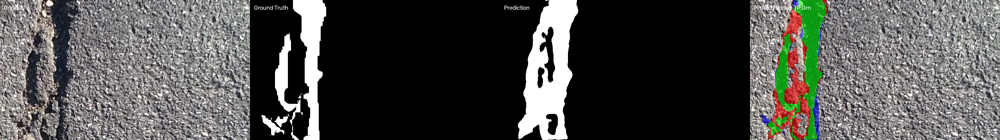  
*Figure 17: Crack500 test example — Median rank 1 (Dice = 0.7302) (TEST).*

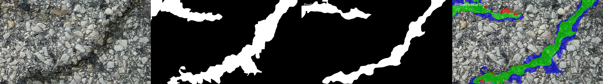  
*Figure 18: Crack500 test example — Median rank 2 (Dice = 0.7303) (TEST).*

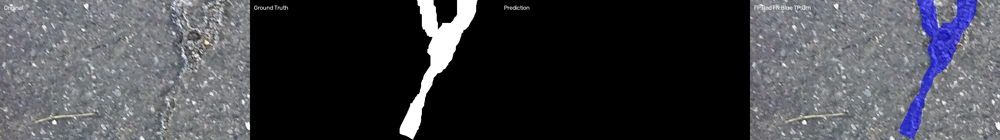  
*Figure 19: Crack500 test example — Worst rank 1 (Dice = 0.0000, empty prediction) (TEST).*

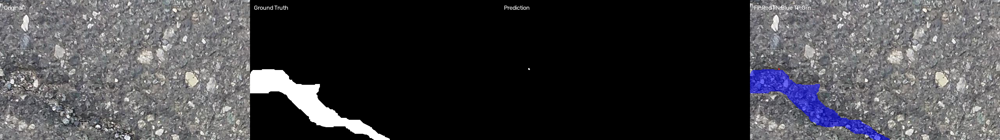  
*Figure 20: Crack500 test example — Worst rank 2 (Dice = 0.0000, empty prediction) (TEST).*

##### CFD Test Examples
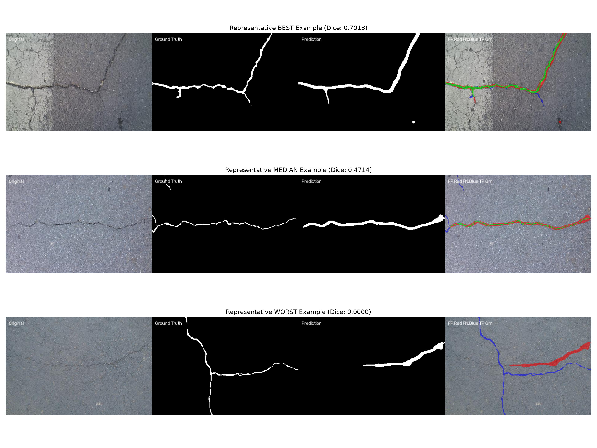  
*Figure 21: CFD external test set inspection panels showing best, median, and worst predictions (TEST).*

---

## 5. Morphological Geometry Extraction

All geometry measurements are reported in **pixels**.

- **Algorithmic Methods**:
  - Skeleton Step Length: graph traversal over medial axis pixels counting 1.0 for orthogonal links and $\sqrt{2}$ for diagonal links.
  - Caliper Width: Euclidean Distance Transform sampled along skeleton (`width_mode="edt2"`).
  - Method Uncertainty: $\mathbf{\pm 1.0\,\text{px}}$ method uncertainty (`crack_geometry.py`).

### 5.1 Empty Predictions Analysis & Error Statistics (All 1,087 Images)

- In the test split, **all 1,087 true ground-truth masks contain cracks** (0 empty ground-truth masks).
- **17 predicted masks are empty** (16 had 0 pixels, 1 had $< 20\,\text{px}$, filtered out by $A_{\min} = 20\,\text{px}$). For these 17 images, ground-truth cracks have a mean length of $283.34\,\text{px}$ and mean width of $17.26\,\text{px}$.
- In `measure_crack`, empty masks evaluate to $L = 0.0\,\text{px}$ and $W = 0.0\,\text{px}$, resulting in an error of $-L_{\text{gt}}$ and $-W_{\text{gt}}$.

#### Geometry Error Metrics (`geometry_results.csv`, TEST)

| Population | Metric | GT Mean | Predicted Mean | Mean Error (Signed) | Mean Absolute Error (MAE) |
| :--- | :--- | :---: | :---: | :---: | :---: |
| **All 1,087 Images** | Crack Length ($L_{\text{px}}$) | 732.85 px | 693.79 px | -39.06 px | **140.32 px** |
| | Transverse Width ($\bar{W}_{\text{px}}$) | 19.01 px | 19.80 px | +0.80 px | **4.74 px** |
| **Excluding 17 Empty Predictions ($N = 1,070$)** | Crack Length ($L_{\text{px}}$) | 739.99 px | 704.81 px | -35.18 px | **138.04 px** |
| | Transverse Width ($\bar{W}_{\text{px}}$) | 19.03 px | 20.11 px | +1.08 px | **4.54 px** |

- **Uncertainty Statements**:
  - Across all 1,087 images: *width uncertainty is about +-1 px from the method plus the model's per-image error (mean absolute error 4.7 px on Crack500 test).*
  - Excluding the 17 empty predictions ($N = 1,070$): *width uncertainty is about +-1 px from the method plus the model's per-image error (mean absolute error 4.5 px on Crack500 test non-empty predictions).*

### 5.2 Geometric Distributions on Cracked Predictions ($N = 1,070$)

| Metric | Mean | Median (p50) | 95th Percentile (p95) |
| :--- | :---: | :---: | :---: |
| **Skeleton Length ($L_{\text{px}}$)** | 704.81 px | 676.66 px | 1322.84 px |
| **Mean Transverse Width ($\bar{W}_{\text{px}}$)** | 20.11 px | 18.80 px | 34.83 px |
| **Maximum Caliper Width ($W_{\max, \text{px}}$)** | 40.95 px | 38.73 px | 70.00 px |
| **95th Percentile Width ($W_{95, \text{px}}$)** | 34.42 px | 32.25 px | 61.90 px |
| **Crack Area ($A_{\text{px}}$)** | 13,516.25 px | 11,912.00 px | 29,692.00 px |
| **Surface Area Fraction (%)** | 5.87% | 5.17% | 12.89% |
| **Principal Orientation ($\theta_{\text{deg}}$)** | 90.14° | 89.55° | 178.01° |
| **Connected Components ($N_{\text{comp}}$)** | 1.98 | 1.00 | 5.00 |
| **Topological Branch Points ($N_{\text{branch}}$)** | 10.68 | 7.00 | 30.55 |
| **Topological Endpoints ($N_{\text{end}}$)** | 7.03 | 6.00 | 16.00 |

#### Figures: Geometry Overlays
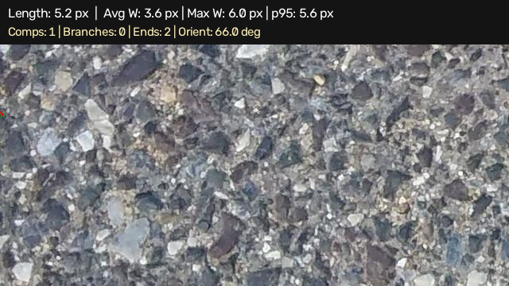  
*Figure 22: Crack geometry overlay sample 01 showing green mask, red skeleton, and metrics text banner (TEST).*

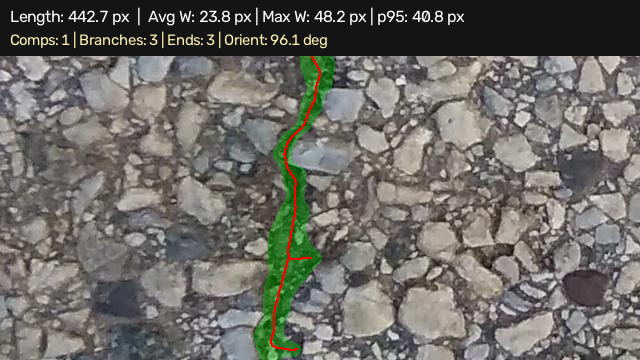  
*Figure 23: Crack geometry overlay sample 04 showing green mask, red skeleton, and metrics text banner (TEST).*

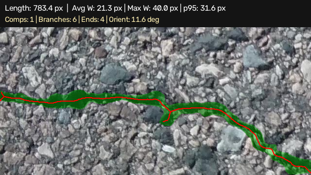  
*Figure 24: Crack geometry overlay sample 08 showing green mask, red skeleton, and metrics text banner (TEST).*

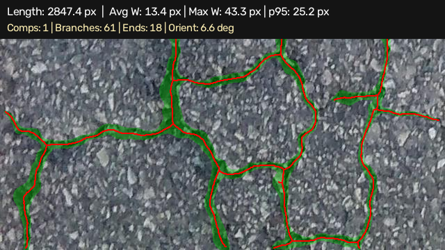  
*Figure 25: Crack geometry overlay sample 12 showing green mask, red skeleton, and metrics text banner (TEST).*

---

## 6. Appendix: Number Sources & Verification Index

Every numeric value presented in this report is mapped to its exact source file in the accompanying CSV file:
- **File**: [`docs/12_number_sources.csv`](file:///d:/Infosys%20springboards/docs/12_number_sources.csv)
- Total entries indexed: 104 entries covering Project Targets, Classification, Detection, Segmentation, Latency, and Geometry.

