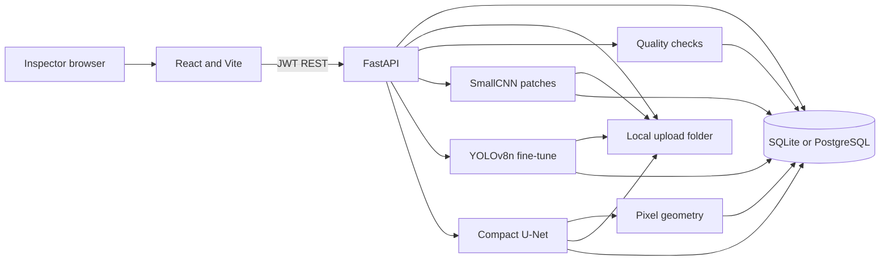

# InfraScan system architecture

This document describes the system as it exists on branch `feature/milestone-1-2-demo`. It matches the code, not a future design.

## What the system does

An inspector signs in, picks a civil asset, opens or creates an inspection, uploads a photograph, and asks the API to analyze it. The API checks image quality and runs whichever of the three baseline models has a weight file on disk. The React app draws the overlay, the mask, the boxes, and the pixel geometry. The result row is stored in the database.

If a weight file is missing, that task returns status `unavailable`. The API does not invent a label, a box, or a mask.

## Diagram

## Layers

| Layer | Technology | Where it lives |
|---|---|---|
| Web UI | React, TypeScript, Vite, Tailwind | `frontend/src` |
| API | FastAPI, Pydantic v2 | `backend/app` |
| Auth | JWT (`python-jose`), bcrypt password hashes, five roles | `backend/app/core`, `backend/app/routers/auth.py` |
| Database | SQLAlchemy 2. SQLite file `backend/infrascan.db` by default. PostgreSQL if `DATABASE_URL` is set. | `backend/app/database.py`, `docker-compose.yml` |
| Files | Local folder `backend/uploads` | `backend/app/services/storage.py` |
| Classical image ops | OpenCV and Pillow | `backend/app/services/preprocessing.py`, `backend/app/ml/preprocess.py` |
| Models | PyTorch SmallCNN and U-Net. Ultralytics YOLOv8n fine-tune. | `backend/app/ml`, `scripts/ml` |
| Weights | Local files under `models/weights`. Not committed. | `models/weights/*.pt` |

Python 3.14 cannot install PyTorch. Training and model inference use the Python 3.12 virtual environment in `backend/venv`.

## Request path for one analysis

1. `POST /auth/login` returns a JWT.
2. `POST /inspections/` creates an inspection for an asset.
3. `POST /inspections/{id}/images` checks the file type, size, minimum resolution, and MD5 duplicate, then stores blur and brightness.
4. `POST /images/{id}/analyze` reads the stored file and calls `app.ml.inference.analyze_image`.
5. The handler writes `image_analyses`, plus `analysis_{id}_overlay.jpg` and, when a mask exists, `analysis_{id}_mask.png`.
6. The inspection page loads `GET /inspections/{id}/analyses` and shows the overlay through authenticated image routes.

## Models

| Model | Input | Output | Training data |
|---|---|---|---|
| SmallCNN | 64×64 RGB patch | crack or non-crack | DeepCrack patches. Background patches are the non-crack class. |
| U-Net, 8 base channels | 128×128 RGB | binary mask | DeepCrack pairs. Image and mask share resize and flip. |
| YOLOv8n fine-tune | full photo | boxes for D00, D10, D20, D40 | A capped RDD2022 Czech subset converted from Pascal VOC XML. |

Geometry (area, skeleton length, width, bounding size, coverage) is computed from the U-Net mask. The unit is pixels. There is no camera calibration, so these are not millimetres.

## Roles

| Role | What they can do in this build |
|---|---|
| Administrator | Users, assets, inspections, upload, analysis |
| Infrastructure Manager | Assets, inspections, upload, analysis |
| Civil Engineer | View assets and inspections, run analysis |
| Infrastructure Inspector | Inspections assigned to them, upload, analysis |
| Maintenance Engineer | View only. Analysis returns 403. |

## What is intentionally not in this build

- No cloud object storage. Files stay on disk.
- No GPU requirement. Training scripts set `device="cpu"`.
- No physical crack width in millimetres.
- No claim that COCO-pretrained YOLO, without the fine-tune, detects road damage. Inference loads `models/weights/yolo_rdd.pt` only.

## Database in use

The process that served the demonstration uses SQLite at `backend/infrascan.db`. Tables are `users`, `roles`, `infrastructure_assets`, `inspections`, `inspection_images`, `image_analyses`, and `audit_logs`. Image rows point at an inspection. An analysis row points at one image. Docker is not installed on this PC, so the PostgreSQL service in Compose was not started.

Detection boxes are drawn only when `models/reports/yolo_metrics.json` records a validation mAP50 of at least 0.05. The saved value is 0.0004, so the API returns an empty box list and the sentence that no reliable boxes were generated.

## What was executed

On 2026-11-02 the API was started from `backend` with the Python 3.12 virtualenv, and Vite served `http://127.0.0.1:5173/` (HTTP 200). `GET /health` returned version 0.2.0. `scripts/smoke_api.py` logged in, created an inspection, uploaded two real sample images, and stored analysis rows. A later pytest run reported `23 passed, 29 warnings in 11.51s`. `scripts/browser_demo.py` then signed in, created an inspection, uploaded `11120.jpg`, and displayed the analysis panel. Screenshots are in `docs/demo_screenshots/`. Metric files are described in `docs/MODEL_EVALUATION_REPORT.md`.
