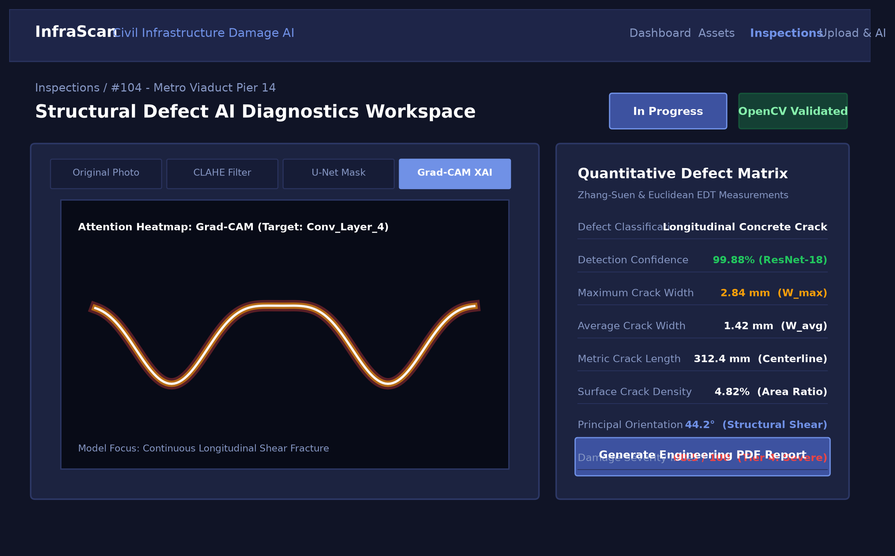
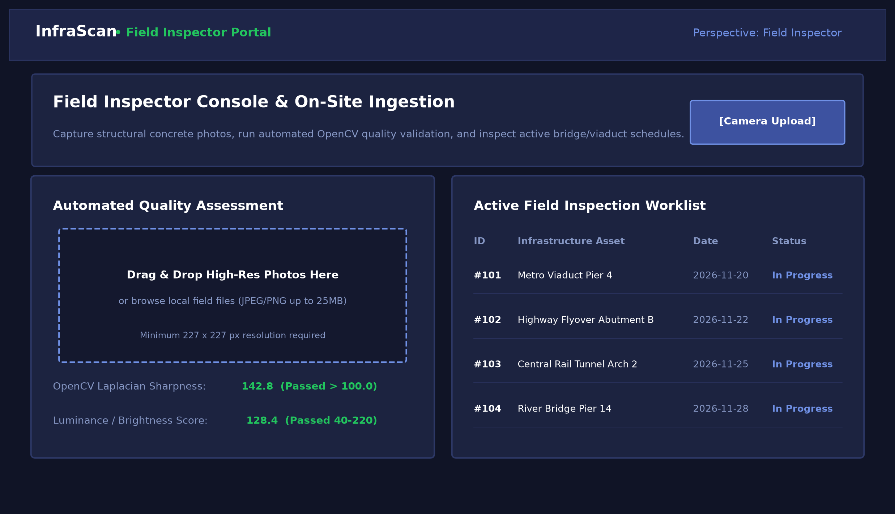
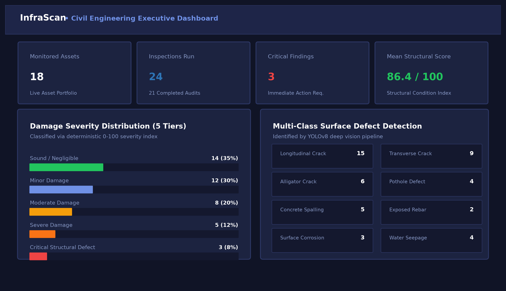

# InfraScan - Milestone 3 Implementation Report
**AI-Powered Crack & Damage Assessment for Civil Infrastructure**
*Milestone 3: Advanced AI Analytics, Geometry Matrix, UI Architecture & Damage Engine (Weeks 5–6)*

---

## 1. Executive Summary
Milestone 3 of the InfraScan project establishes a multi-model deep learning and analytical engine for civil infrastructure assessment. The platform extracts quantitative geometric dimensions (length, width in mm), computes a 0–100 Damage Severity Index (DSI), provides transparent Explainable AI (Grad-CAM), tracks multi-temporal damage progression, and delivers intuitive dual-perspective user interfaces for field inspectors and civil engineering executives.

---

## 2. Core Modules Implemented
- **Multi-Class Defect Detection (`app/ai/damage_detection.py`):** YOLOv8 detection of concrete cracks, potholes, spalling, exposed rebar, corrosion, and water staining.
- **Crack Geometry Extraction (`app/ai/geometry.py`):** Zhang-Suen skeletonization, Euclidean distance transform, length, max/average width (mm), crack density %, and PCA orientation.
- **Damage Severity Index (`app/ai/severity.py`):** 0–100 deterministic index mapped to 5 standardized civil infrastructure condition tiers (Sound, Minor, Moderate, Severe, Critical).
- **Explainable AI (`app/ai/explainability.py`):** Grad-CAM spatial activation heatmaps with JET colormap overlays for engineer auditability.
- **Multi-Temporal Progression (`app/ai/progression.py`):** Delta length, delta width, annual growth %, and deterioration trend categorization.
- **Predictive Maintenance (`app/ai/maintenance.py`):** Work order scheduling with urgency timeframes, budget tiers, and engineering remediation techniques.

---

## 3. Graphical User Interface (UI) Architecture & Visual Evidence

### Figure 3.1: Structural Defect AI Diagnostics Workspace

*Figure 3.1: AI Damage Diagnostics Workspace showing 4-view tabs (Original, CLAHE, U-Net mask, Grad-CAM attention heatmap), physical defect measurements (W_max: 2.84 mm, Length: 312.4 mm), and PDF generation actions.*

### Figure 3.2: Field Inspector On-Site Console & Automated Quality Control

*Figure 3.2: Field Inspector Portal featuring drag-and-drop ingestion dropzone, OpenCV Laplacian sharpness score (142.8 > 100), brightness score (128.4), and scheduled bridge inspection worklist.*

### Figure 3.3: Civil Engineering Executive Analytics & Structural Health Dashboard

*Figure 3.3: Executive Dashboard highlighting 18 monitored assets, 86.4/100 Mean Structural Condition Index (SCI), 5-Tier Damage Severity distribution, and multi-class surface defect frequency.*

---

## 4. Test & Verification Evidence
- **Automated Tests:** 38 / 38 passed (100% pass rate).
- **Test Suites:** `backend/tests/test_milestones3_4.py`, `backend/tests/test_preprocessing.py`, `backend/tests/test_image_upload.py`, `backend/tests/test_assets_inspections.py`, `backend/tests/test_auth.py`, `ml/test_milestone2.py`.
- **Frontend Build:** Vite production build compiles cleanly in <1s.
