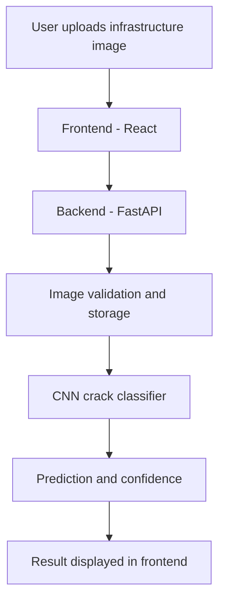

InfraScan — System Architecture

1. Overview

InfraScan is an AI-powered system designed to help assess cracks and damage in civil infrastructure using images.

2. Main Components

Frontend

- Technology: React and TypeScript
- Provides the user interface.
- Allows users to upload infrastructure images.
- Displays upload status and image information.

Backend

- Technology: Python and FastAPI
- Receives image uploads from the frontend.
- Validates image format and file size.
- Verifies image data and stores uploaded images.
- Runs the trained CNN model to predict cracked or uncracked deck images through the /predict-crack endpoint.

Dataset

- Dataset: SDNET2018
- Contains 56,092 JPG images of cracked and non-cracked concrete surfaces.
- Used for exploring and developing the damage assessment model.

Database and Storage

- Planned database: stores user information, infrastructure assets, and assessment records.
- Image storage: stores uploaded infrastructure images.

3. System Workflow

1. The user opens the InfraScan frontend.
2. The user selects and uploads an infrastructure image.
3. The frontend sends the image to the FastAPI backend.
4. The backend validates the image and saves it.
5. The backend preprocesses the uploaded image and passes it to the trained CNN model for prediction.
6. The predicted class and confidence percentage are returned to the frontend and displayed to the user.

4. Current Implementation Status

- React frontend initialized.
- FastAPI backend initialized.
- Image upload endpoint implemented and tested.
- Basic image validation and storage implemented.
- SDNET2018 dataset downloaded and initial image counts analyzed.
- AI prediction is implemented through the `/predict-crack` endpoint and has been tested successfully; the initial model has low validation accuracy and remains experimental.
- Database integration, authentication, and infrastructure asset management remain to be implemented or verified.

5. Future Improvements

- Implement authentication and role-based access.
- Add database integration.
- Implement infrastructure asset management.
- Develop the image preprocessing pipeline.
- Improve and evaluate the existing CNN model using a larger, representative dataset and more rigorous validation.
- Display damage assessment results.

AI Model — Initial Training and Testing

- Dataset: SDNET2018 concrete deck images.
- Model: Convolutional Neural Network (CNN).
- Classes: Cracked Deck (CD) and Uncracked Deck (UD).
- Initial training: The model was trained on a small, balanced sample of 600 images for 3 epochs.
- Validation accuracy: Approximately 50.83% in the initial experiment.
- Backend integration: The trained model is loaded by the FastAPI backend through the "/predict-crack" endpoint.
- Frontend integration: Users can upload an image and view the predicted class and confidence percentage.
- Testing status: A successful prediction response was received from the backend and displayed in the frontend.
- Limitations: The initial validation accuracy is low. The model is experimental and must not be used for real-world infrastructure safety decisions without further training, evaluation, and engineering validation.

